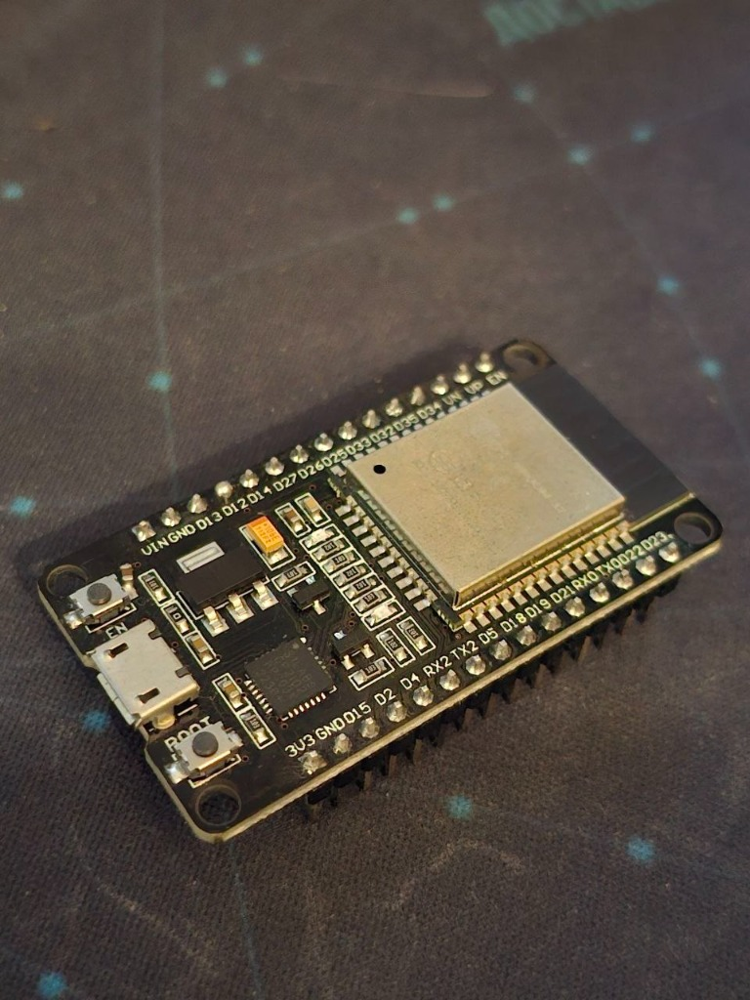
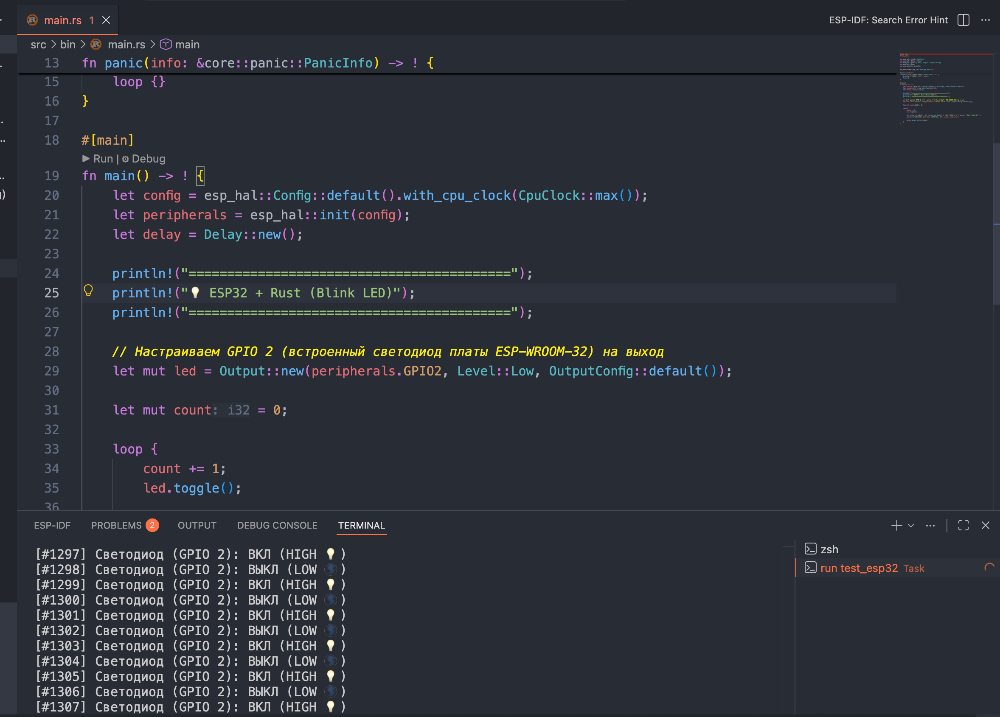
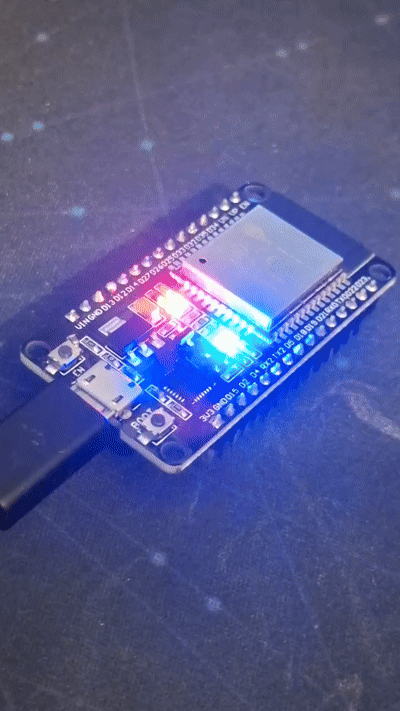

# ESP32 + Rust: Быстрый старт с нуля (помигаем светодиодом)

> Практическое руководство по первому запуску Rust на ESP32: настройка тулчейна (нативно и через Docker), генерация проекта и прошивка через espflash.

- **URL:** https://eagle2000.space/rust/esp32-rust-blink/
- **Date:** 2026-08-10

- **Tags:** rust, esp32, embedded, docker, espflash, gpio, hardware

---
Программирование микроконтроллеров на Rust становится простым, как только вы один раз настроите окружение. В этом гиде мы с нуля подготовим инструменты, разберем код прошивки и заставим светиться встроенный светодиод на плашке **ESP32**.

---

## 1. Проверяем подключение платы

Вставьте USB-кабель в плату ESP32 и убедитесь, что компьютер увидел серийный порт:

```bash
# На macOS:
ls /dev/cu.usbserial*

# На Linux:
ls /dev/ttyUSB*
```



---

## 2. Настраиваем окружение (2 способа)

Выберите один из двух удобных способов сборки проекта:

### Вариант А: Нативная установка через `espup` (Рекомендуется)
Самый быстрый способ для Mac, Linux и Windows. Устанавливаем официальный тулчейн `espup` и прошивальщик `espflash`:

```bash
cargo install espup
cargo install espflash
espup install
```

### Вариант Б: Изолированная сборка в Docker
Если у вас установлен Docker и вы не хотите устанавливать тулчейны в систему, используйте официальный легкий образ Espressif под ESP32:

```bash
# Скачиваем образ с преднастроенным тулчейном Rust для ESP32
docker pull espressif/idf-rust:esp32_1.93.0.0

# Компилируем проект внутри Docker-контейнера
docker run --rm -v $PWD:/project -w /project espressif/idf-rust:esp32_1.93.0.0 cargo build
```

---

## 3. Генерируем проект шаблона

Для генерации готовой структуры проекта используем `cargo-generate` и официальный шаблон `esp-rs`:

```bash
cargo install cargo-generate
cargo generate esp-rs/esp-idf-template cargo
```

В появившемся интерактивном меню задаем параметры:
- **Project Name**: `esp32-blink`
- **MCU**: `esp32`
- **Advanced Options**: `false`

Утилита автоматически создаст структуру проекта с файлом конфигурации `.cargo/config.toml`:

```toml
[build]
target = "xtensa-esp32-none-elf"

[target.xtensa-esp32-none-elf]
runner = "espflash flash --monitor --chip esp32"
```

---

## 4. Разбор кода (`src/main.rs`)

Откройте сгенерированный файл `src/main.rs`. Программа на микроконтроллере отличается от обычной программы на ПК: здесь отключена библиотека `std` (`#![no_std]`) и стандартная точка входа C-runtime (`#![no_main]`).

### Интерактивные слайды кода:


### 💻 Слайд 1. Каркас no_std и Паника


```rust
// ?ignore
#![no_std]
#![no_main]

use core::panic::PanicInfo;
#[panic_handler]
fn panic(_info: &PanicInfo) -> ! {
    // В реальной прошивке здесь логгируют ошибку в UART
    loop {}
}

fn main() {
    // Точка входа прошивки без стандартной библиотеки std
}
```

**Разбор каркаса #![no_std]**
- **#![no_std]**: Отключает тяжелый C-runtime и стандартную библиотеку OS.
- **#![no_main]**: Отменяет поиск стандартной точки входа main.
- **#[panic_handler]**: Функция, вызываемая компилятором при любой ошибке паники в микроконтроллере.


### 💻 Слайд 2. Настройка GPIO на выход


```rust
struct GpioPin;
struct OutputConfig;
struct Output;

impl Output {
    fn new(_pin: GpioPin, _config: OutputConfig) -> Self {
        Output
    }
    fn set_high(&mut self) {}
    fn set_low(&mut self) {}
}
fn configure_gpio() {
    let pin_gpio2 = GpioPin;
    let mut led = Output::new(pin_gpio2, OutputConfig);

    // Управляем уровнем напряжения на пине
    led.set_high(); // 3.3V (Светодиод горит)
    led.set_low();  // 0.0V (Светодиод гаснет)
}

fn main() {
    configure_gpio();
    println!("GPIO 2 сконфигурирован успешно!");
}
```

**Конфигурирование GPIO в Rust**
- **Захват пина**: Безопасность типов Rust гарантирует, что пин GPIO2 не может быть одновременно использован в двух разных местах программы.
- **Level::High (3.3V)**: Подает высокий уровень напряжения на вывод.
- **Level::Low (0.0V)**: Подает нулевой уровень (заземление).


### 💻 Слайд 3. Бесконечный цикл мигания


```rust
struct Led {
    is_on: bool,
}

impl Led {
    fn toggle(&mut self) {
        self.is_on = !self.is_on;
    }
}
fn blink_simulation() {
    let mut led = Led { is_on: false };

    for step in 1..=4 {
        led.toggle();
        let status = if led.is_on { "ВКЛ (HIGH 💡)" } else { "ВЫКЛ (LOW 🌑)" };
        println!("[Шаг {}] Состояние светодиода: {}", step, status);
    }
}

fn main() {
    blink_simulation();
}
```

**Бесконечный цикл и переключение состояния**
- **led.toggle()**: Атомарно меняет состояние выхода с High на Low или наоборот.
- **Delay**: Использование аппаратного таймера отсчитывает ровно 1000 мс паузы.
- **loop**: Бесконечный цикл гарантирует, что прошивка продолжает работу всё время, пока подается питание.


### Итоговый файл `src/main.rs`:

```rust
#![no_std]
#![no_main]

use esp_hal::clock::CpuClock;
use esp_hal::delay::Delay;
use esp_hal::gpio::{Level, Output, OutputConfig};
use esp_hal::main;
use esp_println::println;

esp_bootloader_esp_idf::esp_app_desc!();

#[panic_handler]
fn panic(info: &core::panic::PanicInfo) -> ! {
    println!("PANIC: {:?}", info);
    loop {}
}

#[main]
fn main() -> ! {
    // 1. Получаем контроль над аппаратурой чипа
    let config = esp_hal::Config::default().with_cpu_clock(CpuClock::max());
    let peripherals = esp_hal::init(config);
    let delay = Delay::new();

    println!("==========================================");
    println!("💡 ESP32 + Rust (Blink LED)");
    println!("==========================================");

    // 2. Настраиваем синий встроенный светодиод (GPIO 2)
    let mut led = Output::new(peripherals.GPIO2, Level::Low, OutputConfig::default());
    let mut count = 0;

    // 3. Бесконечный цикл работы платы
    loop {
        count += 1;
        led.toggle();

        let state = if led.is_set_high() { "ВКЛ (HIGH 💡)" } else { "ВЫКЛ (LOW 🌑)" };
        println!("[#{:03}] Светодиод: {}", count, state);

        delay.delay_millis(1000);
    }
}
```

---

## 5. Прошиваем плату и смотрим результат

Запустите сборку и прошивку одной командой:

```bash
cargo run --release
```

Или вызовите `espflash` напрямую:

```bash
espflash flash target/xtensa-esp32-none-elf/release/esp32-blink --monitor
```

Утилита сама определит подключенный порт (например, `/dev/cu.usbserial-0001`), скомпилирует проект, загрузит прошивку в флеш-память ESP32 и откроет серийный монитор логов во встроенном терминале VS Code:





А на самой плате ритмично замигает синий светодиод! 🎉

---

## Проверьте свои знания

Пройдите короткий квиз по материалу статьи:


### 📝 Тест: Мигаем светодиодом на ESP32 и Rust


**1. Зачем в начале прошивки под микроконтроллер указывается атрибут #![no_std]?**

- [ ] Чтобы ускорить сборку проекта в несколько раз
- [ ] Чтобы отключить стандартную библиотеку std, требующую операционную систему
- [ ] Чтобы включить автоматическую оптимизацию памяти
- [ ] Чтобы разрешить использование глобальных переменных

**2. Что выполняет макрос #[panic_handler] в Rust?**

- [ ] Перезапускает операционную систему компьютеры
- [ ] Определяет функцию, вызываемую компилятором при возникновении паники на микроконтроллере
- [ ] Автоматически исправляет синтаксические ошибки
- [ ] Логирует ошибки в веб-сервер

**3. Как Rust гарантирует безопасность при работе с ножкой GPIO (например, GPIO 2)?**

- [ ] Через динамическую проверку типов во время работы
- [ ] За счет модели владения и системы типов (Zero-Cost Abstractions), запрещающей доступ к пину из двух мест одновременно
- [ ] Используя виртуальную машину Java
- [ ] За счет встроенной операционной системы FreeRTOS

**4. Что делает метод led.toggle()?**

- [ ] Удаляет ножку GPIO из памяти
- [ ] Инвертирует текущий уровень напряжения на выводе (с High на Low или с Low на High)
- [ ] Сбрасывает микроконтроллер в заводские настройки
- [ ] Измеряет силу тока в цепи

**5. Почему в прошивках под микроконтроллеры функция main не должна завершаться?**

- [ ] Потому что после выхода из main компилятор выдаст ошибку
- [ ] Потому что микроконтроллер работает непрерывно, пока на него подается питание, и завершение программы приведет к неопределенному поведению
- [ ] Потому что это требование стандарта C99
- [ ] Потому что иначе отключится модуль Wi-Fi

---

## Что дальше?

В следующих статьях серии мы продолжим использовать эту настройку для работы с физическими кнопками, прерываниями, датчиками по I2C/SPI и Wi-Fi! 🦀

